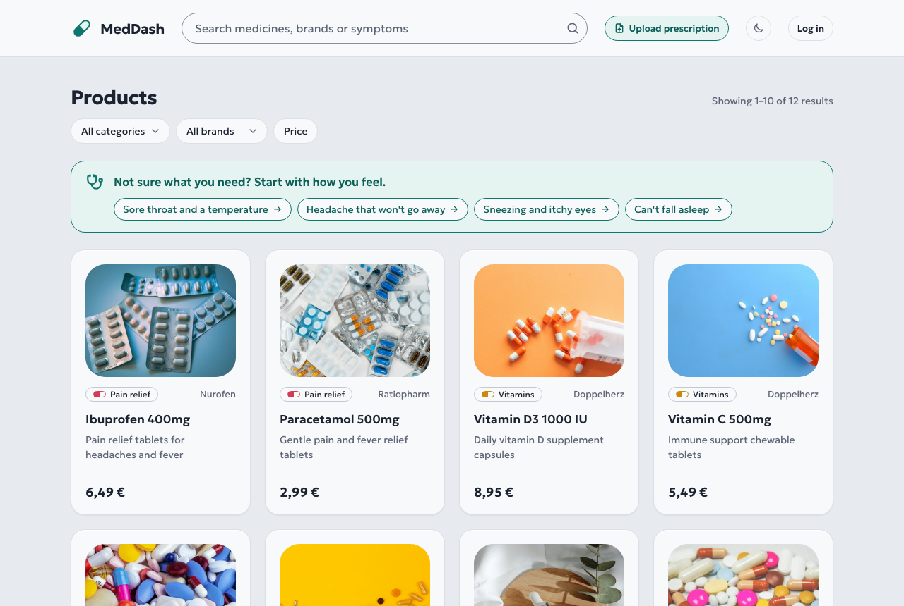
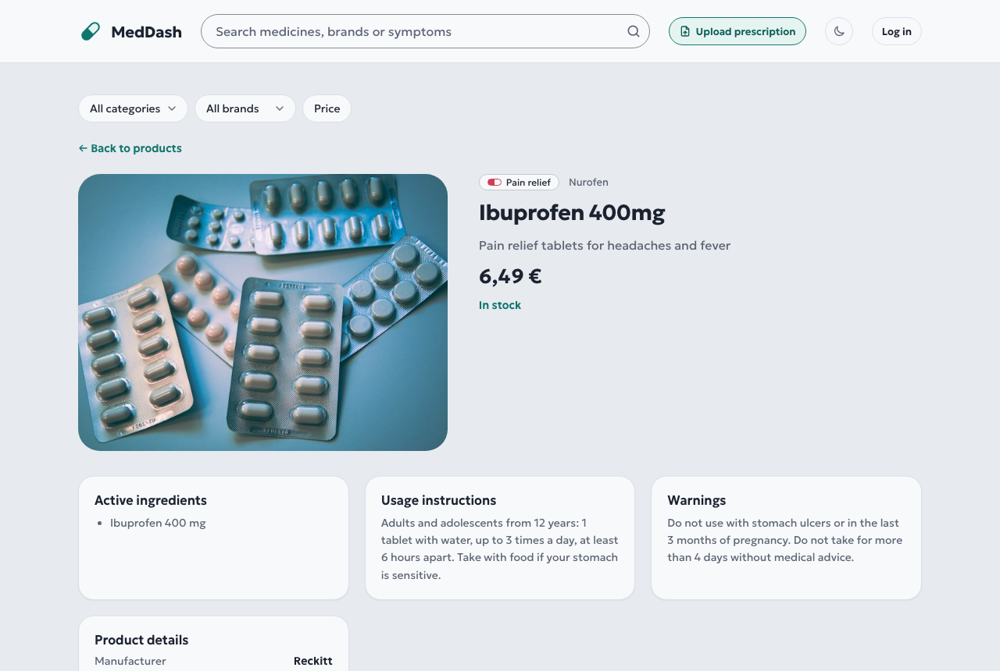
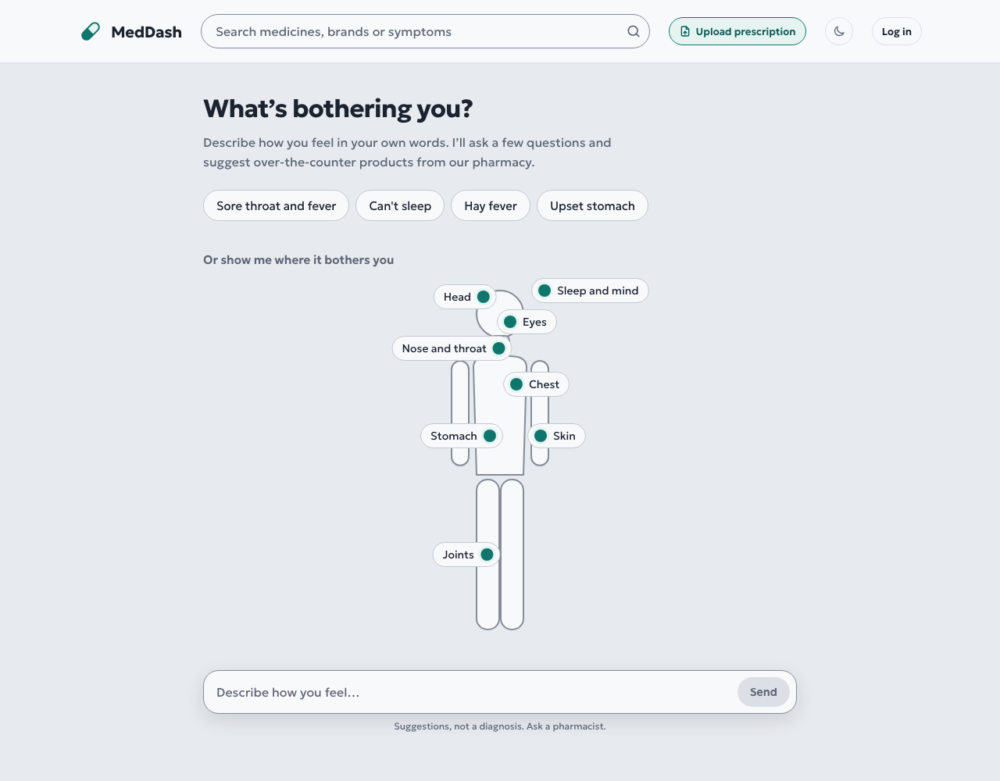
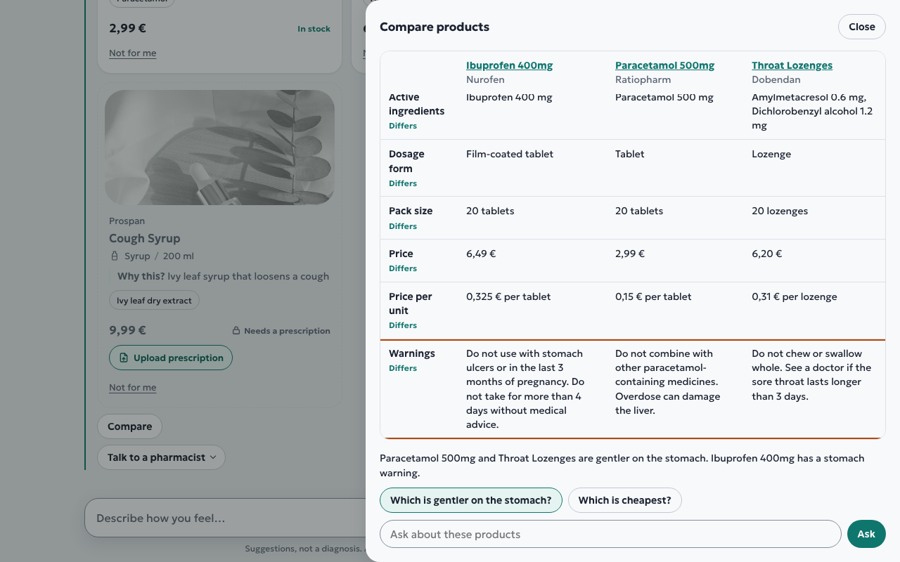

<div align="center">

# 💊 MedDash

**An online pharmacy you can run on your laptop.**
Search the shelves, read the label, ask the pharmacist.

React 18 · Vite · TypeScript · Express · zod · Postgres · Drizzle

</div>



---

## 🏪 The pharmacy in one picture

Think of MedDash as a small pharmacy. Each part of the code has a job in the shop:

| In the shop             | In the code                                  | Where                                   |
| ----------------------- | -------------------------------------------- | --------------------------------------- |
| 🪟 Shop window & aisles | Search, filters, product cards, detail pages | [`apps/web`](apps/web) · port **5173**  |
| 🧑‍⚕️ The counter          | Express API that answers every question      | [`apps/server`](apps/server) · **3001** |
| 🗄️ The stock room       | Postgres 16 in Docker                        | host port **5433**                      |
| 📋 The rulebook         | zod schemas: what a valid request looks like | `apps/server/src/schemas`               |


A request walks the same path every time: **route → controller → service → db**. The Vite dev server forwards
anything under `/api` to the API, so the browser only ever talks to one address.

---

## 🔑 Open the shop in 5 steps

You need **Node.js 22+**, **[pnpm](https://pnpm.io)** (version pinned in `package.json`) and **Docker**.

```bash
pnpm install                                   # 1. bring in the supplies
cp apps/server/.env.example apps/server/.env   # 2. cut the keys (set JWT_SECRET, see below)
pnpm db:up                                     # 3. unlock the stock room (Postgres in Docker)
pnpm db:migrate && pnpm db:seed                # 4. build the shelves and stock them
pnpm dev                                       # 5. open the doors
```

Then walk in at **<http://localhost:5173>** 🎉

<details>
<summary>🔐 What goes in <code>.env</code>?</summary>

| Variable       | Needed? | What it is                                                   |
| -------------- | ------- | ------------------------------------------------------------ |
| `DATABASE_URL` | yes     | Where the stock room is                                      |
| `JWT_SECRET`   | yes     | At least 32 characters. Make one with `openssl rand -hex 32` |
| `PORT`         | no      | API port, defaults to 3001                                   |
| `NODE_ENV`     | no      | `production` turns on `Secure` cookies                       |

The server checks these at startup and stops with a readable message if one is wrong.

</details>

<details>
<summary>🗄️ More about the stock room</summary>

- Postgres runs on host port **5433**, so it doesn't fight with a Postgres you may already have on 5432.
- It holds two databases: `meddash` for you, and `meddash_test`, which the server tests set up themselves.
- `pnpm db:seed` throws out all products and restocks from the seed catalogue. It refuses to run in production, and
  against a database that isn't local unless you set `ALLOW_REMOTE_SEED=1`.
- `pnpm db:down` closes the stock room but keeps the data.

</details>

---

## 🛍️ Take the tour

### 1. Find it

Type a name and suggestions appear as you go. Browse by aisle (pain relief, cold & flu, vitamins, skin care),
narrow down by brand and price, and see how prices are spread before you pick a range.

- Autocomplete waits 250 ms and needs 2 letters. A new keystroke cancels the old request, so an old answer never
  overwrites a newer one.
- Fully keyboard friendly: ↑ ↓ to move, Enter to pick, Esc to close, and screen readers hear the result count.


### 2. Read the label

Every product has its own page: active ingredients, how to use it, warnings, pack size and PZN.
Prescription-only medicines are clearly marked and can't be bought without a prescription.



### 3. Ask the pharmacist

Not sure what you need? The **symptom assistant** at `/assistant` works like a short chat at the counter. Describe
your symptoms, or tap where it hurts on the body map, and it suggests real products from the catalogue.

- 🚨 Safety first: red-flag symptoms tell you to see a doctor instead of offering a product.
- 🗂️ A case file remembers what you told it. Refine the answer or start over.
- ⚖️ Compare suggestions side by side.

| Body map                                                    | Compare                                                              |
| ----------------------------------------------------------- | -------------------------------------------------------------------- |
|  |  |

> The assistant runs on a scripted mock engine in the browser for now. The real AI backend plugs in later by
> replacing one file. Plan: [`docs/plans/symptom-assistant/README.md`](docs/plans/symptom-assistant/README.md).

### 4. Become a regular

Create an account, log in, log out. Your session lives in a secure cookie.
Light or dark? Your choice, and the shop remembers it.

---

## 🧑‍⚕️ Talk to the counter (API)

Interactive docs live at **<http://localhost:3001/docs>** (raw spec: `/openapi.json`).

| Ask                             | And you get                                                                                                                                                   |
| ------------------------------- | ------------------------------------------------------------------------------------------------------------------------------------------------------------- |
| `GET /products`                 | Every product in the catalogue                                                                                                                                |
| `GET /products/:id`             | One product with all its details (404 if unknown, 400 for a malformed id)                                                                                     |
| `GET /search`                   | Search with `q`, `category`, `brand`, `minPrice`, `maxPrice`, `sort`, `page`                                                                                  |
| `GET /search/facets`            | Counts per category and brand plus the price spread (each filter ignores its own choice)                                                                      |
| `GET /search/suggest`           | Up to 5 products whose name or brand starts with `q` (names first)                                                                                            |
| `POST /auth/register`           | Create an account (`email`, `password` min 8, `name`) and sign in; 409 if the email is taken                                                                  |
| `POST /auth/login`              | Sign in; a wrong email and a wrong password both get the same 401 `Invalid email or password`                                                                 |
| `POST /auth/logout`             | Clear the session cookie (204)                                                                                                                                |
| `GET /auth/me`                  | Who is signed in; 401 without a valid session                                                                                                                 |
| `GET /cart`                     | The signed-in user's cart: lines with current prices, `itemCount`, `subtotal` (401 when signed out)                                                           |
| `POST /cart/items`              | Add `{ productId, quantity }` to the cart (adds to what is there); 409 for prescription-only, out of stock, or more than the stock or 10                      |
| `PATCH /cart/items/:productId`  | Set a line's `quantity` (1–10, not above stock); 404 if the product is not in the cart                                                                        |
| `DELETE /cart/items/:productId` | Remove a line; succeeds if it was not in the cart                                                                                                             |
| `POST /assistant/messages`      | One symptom-assistant turn (`caseFile`, `history`, `userText`) streamed as SSE; signed in, 20 per 10 minutes and 200 per day, 503 without `ANTHROPIC_API_KEY` |

Bad input gets a `400` with `{ error: { message, details } }`.

<details>
<summary>🔒 How sign-in works</summary>

- A JWT (HS256, valid 7 days) in an `httpOnly`, `SameSite=Lax` cookie named `session`, marked `Secure` when
  `NODE_ENV=production`.
- Passwords are hashed with Node's built-in scrypt.
- Logging out clears the cookie. The token itself stays valid until it expires.

</details>

---

## 🧰 The toolbox

Run everything from the repo root.

| Command              | What it does                                         |
| -------------------- | ---------------------------------------------------- |
| `pnpm dev`           | Web and API together                                 |
| `pnpm dev:web`       | Web only                                             |
| `pnpm dev:server`    | API only                                             |
| `pnpm db:up`         | Start Postgres in Docker and wait until healthy      |
| `pnpm db:down`       | Stop Postgres (data is kept)                         |
| `pnpm db:migrate`    | Apply migrations from `apps/server/drizzle`          |
| `pnpm db:seed`       | Replace the products with the seed catalogue         |
| `pnpm test`          | Unit tests in both apps                              |
| `pnpm test:e2e`      | Playwright e2e against the real API and Vite server  |
| `pnpm build`         | Production build of both apps                        |
| `pnpm verify:server` | Lint, format, types, tests with coverage, build      |
| `pnpm verify:web`    | Lint, format, types, tests with coverage, build, e2e |
| `pnpm verify`        | Both of the above                                    |

> ✅ **`verify` is the definition of done.** CI runs the same thing. Both need Postgres running, and `verify:web`
> also needs the dev database migrated and seeded, because its e2e tests use the real API.

---

## 🗺️ What's on the shelf, what's coming

| Status | Feature                                                                        |
| ------ | ------------------------------------------------------------------------------ |
| ✅     | Catalogue in Postgres, product images, search, filters and autocomplete        |
| ✅     | Product detail pages, prescription-only products blocked                       |
| ✅     | Accounts: register, log in, log out                                            |
| ✅     | Symptom assistant: chat, safety layer, case file, compare, body map            |
| 🔜     | New product page with quantity and **Add to cart**, cart page, orders, profile |
| 🔜     | Checkout and payment (Stripe test mode)                                        |
| 🔜     | Admin roles and security hardening                                             |

The full roadmap is in [`docs/PLAN.md`](docs/PLAN.md). The next one up is
[`docs/plans/cart-orders/README.md`](docs/plans/cart-orders/README.md).

---

## 🚀 Deployment (Vercel)

A merge to `main` goes to production, and every PR gets a preview, through Vercel's GitHub integration.
The site and the API are two Vercel projects built from this one repo:

- `meddash` (Root Directory `apps/web`, Vite) serves the site. [`apps/web/vercel.json`](apps/web/vercel.json)
  rewrites `/api/*` to the API project and every other path except `/assets/*` to `index.html`, so the
  browser stays on one domain and the session cookie works unchanged.
- `meddash-api` (Root Directory `apps/server`, Express, domain `meddash-q724.vercel.app`) answers `/api/*`. It strips the `/api` prefix, just
  like the Vite dev proxy. It runs in `fra1`, next to the Neon database in `eu-central-1`.

> **Web previews use production data.** The `/api` rewrite always points at the production API, so signing
> up, filling a cart or placing an order on a web preview writes to the production database. Test changes
> that write data locally. API previews get their own Neon database branch, but the web previews don't call
> them.

One-time setup:

1. Create a hosted Postgres (for example Neon from the Vercel Marketplace).
2. Import the repo in Vercel twice, production branch = `main`: once with Root Directory `apps/web`, once
   with `apps/server`. Point the `/api` rewrite in `apps/web/vercel.json` at the API project's production
   domain.
3. Connect the Neon database to the API project, which sets `DATABASE_URL`, and set `JWT_SECRET`
   (`openssl rand -hex 32`) in its environment variables.
4. Nothing to migrate by hand: [`apps/server/vercel.json`](apps/server/vercel.json) runs `db:migrate` after
   every API build compiles, so code that doesn't compile never changes the schema. That matters for previews, because the Neon integration gives each Git branch its own
   database branch, copied from production when the branch first deploys. A PR's migrations therefore reach
   production as soon as it merges.
5. To fill an empty hosted database with the seed catalogue, run from the repo root (this replaces all products):
   `read -s "url?Paste DATABASE_URL: "; DATABASE_URL="$url" ALLOW_REMOTE_SEED=1 pnpm db:seed; unset url`.
   Preview databases are copied from production when a Git branch first deploys, so seed production first.

---

## 📂 Where things live

```
apps/
  web/      features/<feature>/{components,hooks,api,utils}, shared code in src/lib
  server/   routes -> controllers -> services -> db (Drizzle + Postgres)
            zod schemas in schemas/, OpenAPI in openapi/
docs/
  PLAN.md   the roadmap
  plans/    one folder per bigger piece of work; index in plans/README.md
```

The zod schemas in `apps/server/src/schemas` are the single source of truth for request and response shapes. The
web app mirrors them in each feature's `types.ts`.

---

## 🤖 Working with Claude

The repo comes with its own Claude Code setup: conventions in `CLAUDE.md`, permissions and a format-on-edit hook in
`.claude/settings.json`, dev servers in `.claude/launch.json`, and skills in `.claude/skills`.

1. Pick a task from [`docs/PLAN.md`](docs/PLAN.md) and create a branch.
2. For a big phase (database, auth, orders, payment), write a plan in `docs/plans/` and approve it before any code.
3. Build until `pnpm verify` passes. For a new or changed endpoint, use the `/add-endpoint` skill.
4. Run `/code-review high`, plus `/security-review` for auth, cart, payment and security work.
5. Open the PR, fill in the template, and tick the boxes in `docs/PLAN.md`.

When Claude gets something wrong, the fix PR also adds what would have prevented it: a line in the right
`CLAUDE.md`, a lint rule, a test or a hook.

## 🤝 Contributing

House rules per app live in [`apps/web/CLAUDE.md`](apps/web/CLAUDE.md) and
[`apps/server/CLAUDE.md`](apps/server/CLAUDE.md). The short version: no new dependencies without a chat first, and
never commit `dist`, `coverage` or `test-results`.
