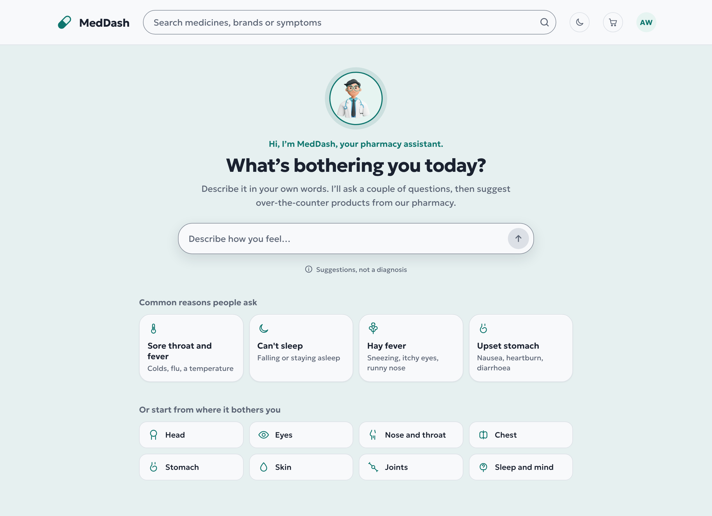
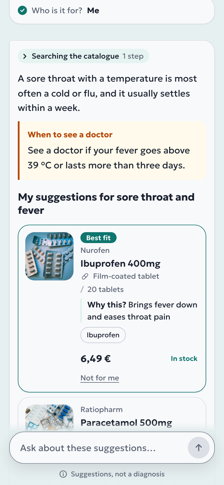
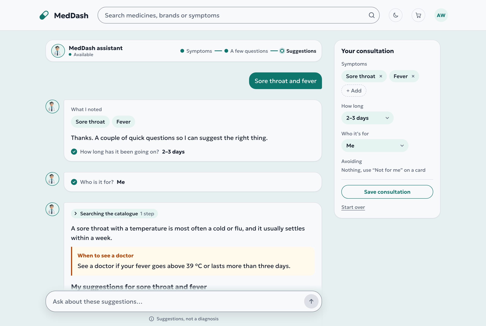
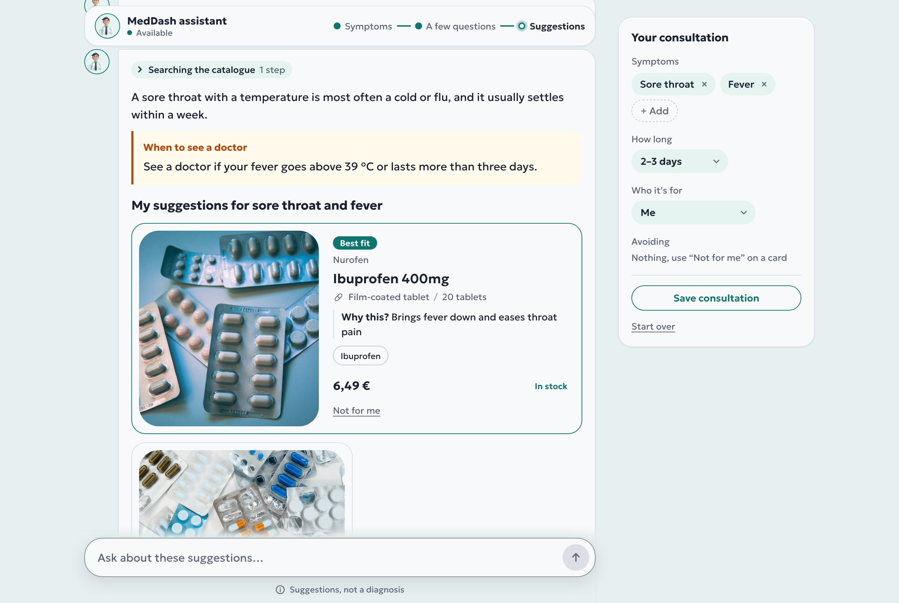
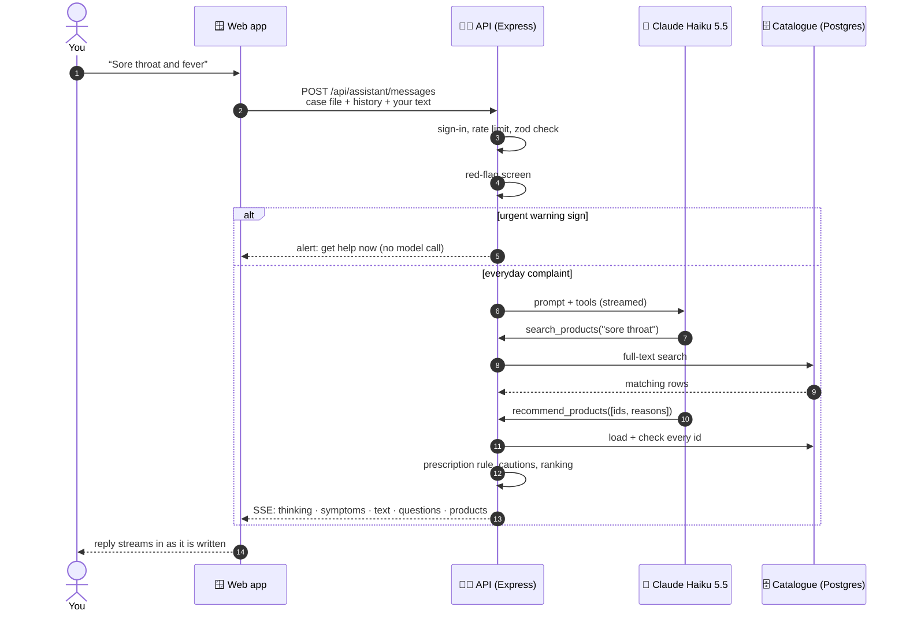
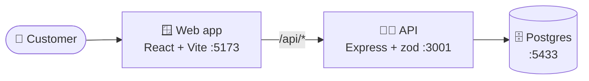
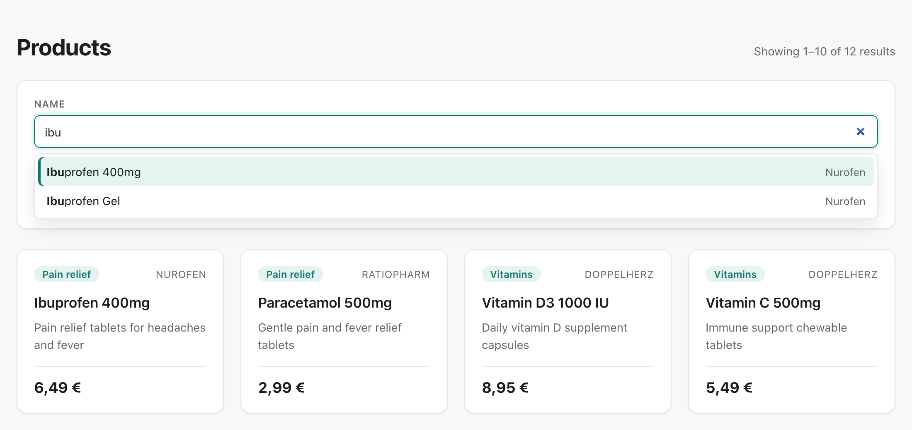
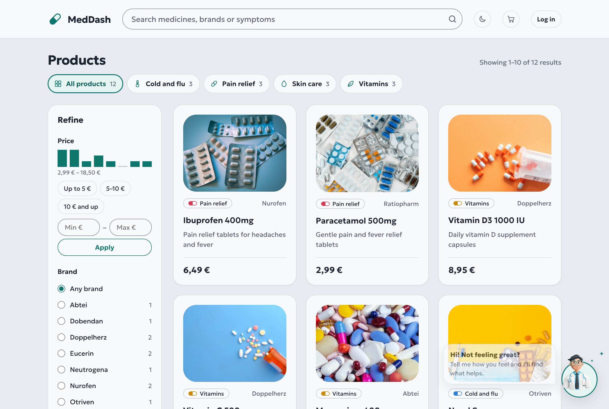
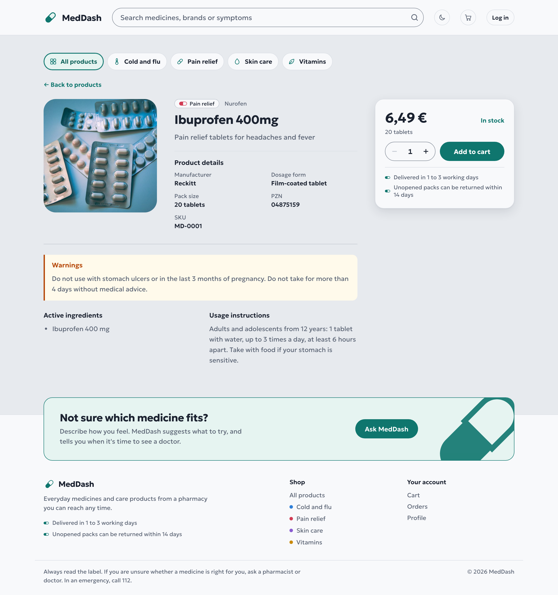

<div align="center">

# 💊 MedDash

**An online pharmacy you can run on your laptop, with a pharmacist that never closes.**
Search the shelves, read the label, and when you don't know what you need, just say how you feel.

React 18 · Vite · TypeScript · Express · zod · Postgres · Drizzle · Claude

<br/>




</div>

---

<a id="assistant"></a>

## 🧑‍⚕️ Meet the MedDash assistant

> **Package leaflet: information for the user**
> *MedDash assistant, conversation, oral (well, typed)*
> Read all of this leaflet carefully before you start chatting, because it contains important information for you.

### 1. What the MedDash assistant is and what it is used for

The assistant is a short chat at the counter. You describe how you feel, in your own words or by tapping where it
bothers you. It asks a couple of questions, the way a pharmacist would, and then hands you a shortlist of
**real products from the MedDash catalogue**, each with a plain reason why.

It is used for everyday complaints: a sore throat, hay fever, a night without sleep, an upset stomach.
It is **not** used for diagnosing anything.

### 2. What you need to know before you use it

**Do not use the assistant** for chest pain, trouble breathing, or anything that feels like an emergency.
It is built to notice: urgent warning signs are screened **on the server, before any AI sees your message**.
When one matches, the assistant stops suggesting products, says to get help now, and makes no model call at all.

**Take special care:**

- 🧾 **It never invents a product.** The model only sees catalogue rows that its own search returned, and
  recommends by id. The server checks every id, loads the product and drops anything unknown.
- 🔒 **Prescription-only stays prescription-only.** Those products are shown apart, greyed out, never as the
  best fit, and can't go in the cart.
- 🤰 **Who it's for changes the answer.** Tell it the medicine is for a child, someone pregnant or someone over 65,
  and cautions from the product's own warnings appear on the cards.
- 🙈 **Your symptoms stay out of the logs.** What you type is health data, so the server never logs message text.
- ⏱️ **It is rate-limited per account** (20 turns per 10 minutes, 200 per day), and you need to be signed in.

### 3. How to use it

| Step                   | What happens                                                                                                                                                                                                                                                                                                                                                                                                                                                           |
| ---------------------- | ---------------------------------------------------------------------------------------------------------------------------------------------------------------------------------------------------------------------------------------------------------------------------------------------------------------------------------------------------------------------------------------------------------------------------------------------------------------------- |
| **1. Say it**          | Type how you feel, tap a common reason (“Sore throat and fever”), or start from where it bothers you (Head, Chest, Skin…). The doctor in the corner of every page opens the chat, and a search that sounds like a symptom offers it too.                                                                                                                                                                                                                               |
| **2. Answer two taps** | “How long has it been going on?” and “Who is it for?” appear as cards of big buttons. Each folds to a single ✓ line once answered. A progress strip shows **Symptoms → A few questions → Suggestions**.                                                                                                                                                                                                                                                                 |
| **3. Read the advice** | A short explanation, a highlighted **When to see a doctor** box, then **My suggestions for …**: a best fit and alternatives, each with “Why this?”. Tap an ingredient to ask about it, or **Not for me** to rule a product out (it remembers why).                                                                                                                                                                                                                     |
| **4. Decide**          | **Compare** puts the top picks side by side, and you can ask the table a question (“which is gentler on the stomach?”). **Talk to a pharmacist** is always one tap away. **Your consultation** on the side keeps the symptoms and answers; change any of them and the assistant answers again. Save the consultation to pick it up later.                                                                                                                              |

| Questions                                                                        | Suggestions                                                                          |
| -------------------------------------------------------------------------------- | ------------------------------------------------------------------------------------ |
|  |  |

### 4. Possible side effects

Like all assistants, this one can get things wrong, although not everybody gets them.

- **Common:** suggests something you've already tried. Use *Not for me → Already tried* and it steers away from it.
- **Uncommon:** words its doctor advice so the **When to see a doctor** box doesn't pick it up, and it shows as a
  normal paragraph instead.
- **Rare:** declines to answer. It then tells you to ask a pharmacist, which is good advice anyway.
- **Not known:** being right about what you have. It suggests products, it does not diagnose. If symptoms get worse
  or don't settle, see a doctor.

### 5. How it is made



- **One seam.** The browser renders a typed list of message parts (`text`, `thinking`, `symptoms`,
  `quickReplies`, `products`, `alert`) and never free-form HTML. Everything model-shaped lives behind it.
- **Stateless server.** Each request carries the case file and a trimmed history, so nothing about your
  conversation is stored on the server.
- **At most 4 tool rounds per turn**, using the plain Anthropic SDK in a small hand-written loop.
- **Measured, not guessed.** `pnpm assistant:eval` replays scripted conversations against the real model and
  checks the answers (it costs real money, so it isn't part of `verify`).

### 6. Contents of the pack and further information

- To run it locally, set `ANTHROPIC_API_KEY` in `apps/server/.env`. Without it, the rest of the shop works and the
  chat says the assistant is not configured. `ASSISTANT_MODEL` picks another model.
- Code: [`apps/web/src/features/assistant`](apps/web/src/features/assistant) (the chat) and
  [`apps/server/src/services/assistant`](apps/server/src/services/assistant) (the counter).
- Plans: [frontend](docs/plans/symptom-assistant/README.md) · [backend](docs/plans/symptom-assistant-backend/README.md).

<sub>This leaflet was last revised when the assistant got its new face.</sub>

---

## 🏪 The pharmacy in one picture

Think of MedDash as a small pharmacy. Each part of the code has a job in the shop:

| In the shop             | In the code                                  | Where                                   |
| ----------------------- | -------------------------------------------- | --------------------------------------- |
| 🪟 Shop window & aisles | Search, filters, product cards, detail pages | [`apps/web`](apps/web) · port **5173**  |
| 🧑‍⚕️ The counter          | Express API that answers every question      | [`apps/server`](apps/server) · **3001** |
| 🗄️ The stock room       | Postgres 16 in Docker                        | host port **5433**                      |
| 📋 The rulebook         | zod schemas: what a valid request looks like | `apps/server/src/schemas`               |



A request walks the same path every time: **route → controller → service → db**. The Vite dev server forwards
anything under `/api` to the API, so the browser only ever talks to one address.

---

## 🔑 Open the shop in 5 steps

You need **Node.js 22+**, **[pnpm](https://pnpm.io)** (version pinned in `package.json`) and **Docker**.

```bash
pnpm install                                   # 1. bring in the supplies
cp apps/server/.env.example apps/server/.env   # 2. cut the keys (set JWT_SECRET, see below)
pnpm db:up                                     # 3. unlock the stock room (Postgres in Docker)
pnpm db:migrate && pnpm db:seed                # 4. build the shelves and stock them
pnpm dev                                       # 5. open the doors
```

Then walk in at **<http://localhost:5173>** 🎉

<details>
<summary>🔐 What goes in <code>.env</code>?</summary>

| Variable       | Needed? | What it is                                                   |
| -------------- | ------- | ------------------------------------------------------------ |
| `DATABASE_URL` | yes     | Where the stock room is                                      |
| `JWT_SECRET`   | yes     | At least 32 characters. Make one with `openssl rand -hex 32` |
| `PORT`         | no      | API port, defaults to 3001                                   |
| `NODE_ENV`     | no      | `production` turns on `Secure` cookies                       |

The server checks these at startup and stops with a readable message if one is wrong.

</details>

<details>
<summary>🗄️ More about the stock room</summary>

- Postgres runs on host port **5433**, so it doesn't fight with a Postgres you may already have on 5432.
- It holds two databases: `meddash` for you, and `meddash_test`, which the server tests set up themselves.
- `pnpm db:seed` throws out all products and restocks from the seed catalogue. It refuses to run in production, and
  against a database that isn't local unless you set `ALLOW_REMOTE_SEED=1`.
- `pnpm db:down` closes the stock room but keeps the data.

</details>

---

## 🛍️ Take the tour

### 1. Find it

Type a name and suggestions appear as you go. Browse by aisle (pain relief, cold & flu, vitamins, skin care),
narrow down by brand and price, and see how prices are spread before you pick a range.

- Autocomplete waits 250 ms and needs 2 letters. A new keystroke cancels the old request, so an old answer never
  overwrites a newer one.
- Fully keyboard friendly: ↑ ↓ to move, Enter to pick, Esc to close, and screen readers hear the result count.



The aisles sit in one row of pills above the results, with how many products each holds.



### 2. Read the label

Every product has its own page. A small image sits next to the name and the facts on the pack (manufacturer, dosage
form, pack size, PZN), with the price and **Add to cart** beside them. Warnings come first underneath, then the
active ingredients and how to use it, all open, nothing to unfold. Prescription-only medicines are clearly marked
and can't be bought without a prescription.



### 3. Ask the pharmacist

Not sure what you need? That's what the [MedDash assistant](#assistant) is for: the doctor in the
corner of every page, and the “Not sure which medicine fits?” panel in the footer, both open it.

### 4. Become a regular

Create an account, log in, log out. Your session lives in a secure cookie.
Light or dark? Your choice, and the shop remembers it.

---

## 🧑‍⚕️ Talk to the counter (API)

Interactive docs live at **<http://localhost:3001/docs>** (raw spec: `/openapi.json`).

| Ask                             | And you get                                                                                                                                                   |
| ------------------------------- | ------------------------------------------------------------------------------------------------------------------------------------------------------------- |
| `GET /products`                 | Every product in the catalogue                                                                                                                                |
| `GET /products/:id`             | One product with all its details (404 if unknown, 400 for a malformed id)                                                                                     |
| `GET /search`                   | Search with `q`, `category`, `brand`, `minPrice`, `maxPrice`, `sort`, `page`                                                                                  |
| `GET /search/facets`            | Counts per category and brand plus the price spread (each filter ignores its own choice)                                                                      |
| `GET /search/suggest`           | Up to 5 products whose name or brand starts with `q` (names first)                                                                                            |
| `POST /auth/register`           | Create an account (`email`, `password` min 8, `name`) and sign in; 409 if the email is taken                                                                  |
| `POST /auth/login`              | Sign in; a wrong email and a wrong password both get the same 401 `Invalid email or password`                                                                 |
| `POST /auth/logout`             | Clear the session cookie (204)                                                                                                                                |
| `GET /auth/me`                  | Who is signed in; 401 without a valid session                                                                                                                 |
| `GET /cart`                     | The signed-in user's cart: lines with current prices, `itemCount`, `subtotal` (401 when signed out)                                                           |
| `POST /cart/items`              | Add `{ productId, quantity }` to the cart (adds to what is there); 409 for prescription-only, out of stock, or more than the stock or 10                      |
| `PATCH /cart/items/:productId`  | Set a line's `quantity` (1–10, not above stock); 404 if the product is not in the cart                                                                        |
| `DELETE /cart/items/:productId` | Remove a line; succeeds if it was not in the cart                                                                                                             |
| `POST /assistant/messages`      | One symptom-assistant turn (`caseFile`, `history`, `userText`) streamed as SSE; signed in, 20 per 10 minutes and 200 per day, 503 without `ANTHROPIC_API_KEY` |
| `POST /assistant/compare`       | A question about 2–4 products (`productIds`, `question`), answered as SSE text plus the table row it is about; same sign-in, limits and 503                   |

Bad input gets a `400` with `{ error: { message, details } }`.

<details>
<summary>🔒 How sign-in works</summary>

- A JWT (HS256, valid 7 days) in an `httpOnly`, `SameSite=Lax` cookie named `session`, marked `Secure` when
  `NODE_ENV=production`.
- Passwords are hashed with Node's built-in scrypt.
- Logging out clears the cookie. The token itself stays valid until it expires.

</details>

---

## 🧰 The toolbox

Run everything from the repo root.

| Command               | What it does                                         |
| --------------------- | ---------------------------------------------------- |
| `pnpm dev`            | Web and API together                                 |
| `pnpm dev:web`        | Web only                                             |
| `pnpm dev:server`     | API only                                             |
| `pnpm db:up`          | Start Postgres in Docker and wait until healthy      |
| `pnpm db:down`        | Stop Postgres (data is kept)                         |
| `pnpm db:migrate`     | Apply migrations from `apps/server/drizzle`          |
| `pnpm db:seed`        | Replace the products with the seed catalogue         |
| `pnpm test`           | Unit tests in both apps                              |
| `pnpm test:e2e`       | Playwright e2e against the real API and Vite server  |
| `pnpm build`          | Production build of both apps                        |
| `pnpm verify:server`  | Lint, format, types, tests with coverage, build      |
| `pnpm verify:web`     | Lint, format, types, tests with coverage, build, e2e |
| `pnpm verify`         | Both of the above                                    |
| `pnpm assistant:eval` | Assistant evals on the real model (costs money)      |

> ✅ **`verify` is the definition of done.** CI runs the same thing. Both need Postgres running, and `verify:web`
> also needs the dev database migrated and seeded, because its e2e tests use the real API.

---

## 🗺️ What's on the shelf, what's coming

| Status | Feature                                                                        |
| ------ | ------------------------------------------------------------------------------ |
| ✅     | Catalogue in Postgres, product images, search, filters and autocomplete        |
| ✅     | Product detail pages, prescription-only products blocked                       |
| ✅     | Accounts: register, log in, log out                                            |
| ✅     | Symptom assistant: chat, safety layer, case file, compare, body map            |
| 🔜     | New product page with quantity and **Add to cart**, cart page, orders, profile |
| 🔜     | Checkout and payment (Stripe test mode)                                        |
| 🔜     | Admin roles and security hardening                                             |

The full roadmap is in [`docs/PLAN.md`](docs/PLAN.md). The next one up is
[`docs/plans/cart-orders/README.md`](docs/plans/cart-orders/README.md).

---

## 🚀 Deployment (Vercel)

A merge to `main` goes to production, and every PR gets a preview, through Vercel's GitHub integration.
The site and the API are two Vercel projects built from this one repo:

- `meddash` (Root Directory `apps/web`, Vite) serves the site. [`apps/web/vercel.json`](apps/web/vercel.json)
  rewrites `/api/*` to the API project and every other path except `/assets/*` to `index.html`, so the
  browser stays on one domain and the session cookie works unchanged.
- `meddash-api` (Root Directory `apps/server`, Express, domain `meddash-q724.vercel.app`) answers `/api/*`. It strips the `/api` prefix, just
  like the Vite dev proxy. It runs in `fra1`, next to the Neon database in `eu-central-1`.

> **Web previews use production data.** The `/api` rewrite always points at the production API, so signing
> up, filling a cart or placing an order on a web preview writes to the production database. Test changes
> that write data locally. API previews get their own Neon database branch, but the web previews don't call
> them.

One-time setup:

1. Create a hosted Postgres (for example Neon from the Vercel Marketplace).
2. Import the repo in Vercel twice, production branch = `main`: once with Root Directory `apps/web`, once
   with `apps/server`. Point the `/api` rewrite in `apps/web/vercel.json` at the API project's production
   domain.
3. Connect the Neon database to the API project, which sets `DATABASE_URL`, and set `JWT_SECRET`
   (`openssl rand -hex 32`) in its environment variables.
4. Nothing to migrate by hand: [`apps/server/vercel.json`](apps/server/vercel.json) runs `db:migrate` after
   every API build compiles, so code that doesn't compile never changes the schema. That matters for previews, because the Neon integration gives each Git branch its own
   database branch, copied from production when the branch first deploys. A PR's migrations therefore reach
   production as soon as it merges.
5. To fill an empty hosted database with the seed catalogue, run from the repo root (this replaces all products):
   `read -s "url?Paste DATABASE_URL: "; DATABASE_URL="$url" ALLOW_REMOTE_SEED=1 pnpm db:seed; unset url`.
   Preview databases are copied from production when a Git branch first deploys, so seed production first.

---

## 📂 Where things live

```
apps/
  web/      features/<feature>/{components,hooks,api,utils}, shared code in src/lib
  server/   routes -> controllers -> services -> db (Drizzle + Postgres)
            zod schemas in schemas/, OpenAPI in openapi/
docs/
  PLAN.md   the roadmap
  plans/    one folder per bigger piece of work; index in plans/README.md
```

The zod schemas in `apps/server/src/schemas` are the single source of truth for request and response shapes. The
web app mirrors them in each feature's `types.ts`.

---

## 🤖 Working with Claude

The repo comes with its own Claude Code setup: conventions in `CLAUDE.md`, permissions and a format-on-edit hook in
`.claude/settings.json`, dev servers in `.claude/launch.json`, and skills in `.claude/skills`.

1. Pick a task from [`docs/PLAN.md`](docs/PLAN.md) and create a branch.
2. For a big phase (database, auth, orders, payment), write a plan in `docs/plans/` and approve it before any code.
3. Build until `pnpm verify` passes. For a new or changed endpoint, use the `/add-endpoint` skill.
4. Run `/code-review high`, plus `/security-review` for auth, cart, payment and security work.
5. Open the PR, fill in the template, and tick the boxes in `docs/PLAN.md`.

When Claude gets something wrong, the fix PR also adds what would have prevented it: a line in the right
`CLAUDE.md`, a lint rule, a test or a hook.

## 🤝 Contributing

House rules per app live in [`apps/web/CLAUDE.md`](apps/web/CLAUDE.md) and
[`apps/server/CLAUDE.md`](apps/server/CLAUDE.md). The short version: no new dependencies without a chat first, and
never commit `dist`, `coverage` or `test-results`.
